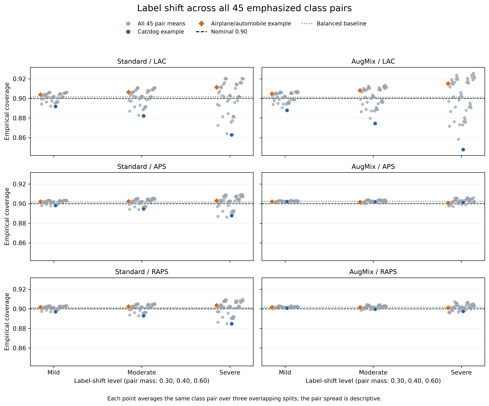

# Conformal Coverage Under Distribution Shift

**Research question:** How does conformal coverage change under controlled image corruption and label shift on CIFAR-10?

This course project compares two CIFAR-style ResNet-18 classifiers and three split-conformal prediction methods. The notebooks are the primary interface; each stage explains its definitions, inputs, checks, and saved outputs.

## Scope

- **Data:** CIFAR-10 for training and clean calibration/evaluation; CIFAR-10-C for the approved corruption conditions; clean CIFAR-10 predictions are reweighted for label shift.
- **Base models:** standard CIFAR-style ResNet-18 and the same architecture trained with AugMix. Both use 32×32 inputs, CIFAR-10 normalization, and 75 training epochs.
- **Conformal methods:** LAC, randomized APS, and randomized RAPS, with nominal marginal coverage 0.90. Calibration is always on clean data; each threshold stays fixed during shifted evaluation. RAPS uses the prespecified exploratory values lambda=0.02 and k_reg=1.
- **Image corruption:** Gaussian noise, defocus blur, and brightness at severities 1, 3, and 5.
- **Label shift:** all 45 unordered pairs of emphasized CIFAR-10 classes, each at mild, moderate, and severe levels, plus balanced: 136 target priors. Images and individual prediction sets do not change; only class weights change. Cat/dog and airplane/automobile are illustrative contrasts within the full enumeration.
- **Splits:** seeds 42, 43, and 44 each create disjoint calibration and evaluation subsets of 5,000 CIFAR-10 test images. The split repetitions overlap and are sensitivity checks, not independent replications.

## Methods

For LAC, the nonconformity score is `1 - p_y(x)`. APS uses randomized cumulative probability mass through the candidate label's rank. RAPS adds `lambda * max(rank - k_reg, 0)` using 1-based ranks. Each method uses the finite-sample split-conformal order statistic `k = ceil((n + 1) * (1 - alpha))`; with 5,000 calibration examples and alpha 0.10, `k = 4501`.

The main metrics are top-1 accuracy, empirical marginal coverage, coverage gap `0.90 - coverage`, average prediction-set size, empty-set rate, and class-conditional coverage/set-size summaries.

## Notebook order

| Notebook | Stage | Work |
|---|---:|---|
| `notebooks/00_environment_and_data.ipynb` | 1 | Environment, CIFAR-10, saved splits |
| `notebooks/01_train_models_local_validation.ipynb` | 2 support | Local sanity checks and timing probe only |
| `notebooks/01_train_models_standard_colab.ipynb` | 2 | Official standard model training |
| `notebooks/01_train_models_augmix_colab.ipynb` | 3 | Official AugMix model training |
| `notebooks/02_cache_model_outputs_colab.ipynb` | 4 | Cache and audit model outputs |
| `notebooks/03_conformal_methods.ipynb` | 5–7 | LAC, APS, RAPS, and corruption results |
| `notebooks/04_label_shift_experiments.ipynb` | 8 | Class-conditional and label-shift analysis |
| `notebooks/05_final_analysis.ipynb` | 9 | Final figures, tables, and interpretation |

More details and the run status of each notebook are in [`notebooks/README.md`](notebooks/README.md).

## Reproduce

Use Python 3.12 or newer with the packages in `requirements.txt`. PyTorch and torchvision should match the available CPU/GPU runtime.

After cloning the repository, run `notebooks/05_final_analysis.ipynb` to recompute the final summaries and display the figures from the saved Stage 4–8 metric CSVs and compact metadata in `results/`. By default, `REGENERATE_FIGURES=False` retains existing PNG/PDF exports and saves missing figure pairs. Set it to `True` in the setup cell to replace existing exports. The notebook does not require datasets, saved split files, prediction caches, checkpoints, or model inference. Its split-integrity check recreates the Stage 1 partitions in memory from seeds 42, 43, and 44.

To recompute the experimental metrics from a GitHub clone, start with `notebooks/03_conformal_methods.ipynb`, then run `notebooks/04_label_shift_experiments.ipynb`. The repository includes all 20 audited Stage 4 prediction caches, the three fixed split-index files, the CIFAR-10 test batch used for label checks, and the saved APS/RAPS randomization values. Stages 5–8 can therefore run from these saved inputs without model inference, a GPU, or CIFAR-10-C downloads. The all-pair rotation section in Stage 8 can also run independently from the saved class-conditional CSVs. The APS clean-data section documents the recorded coverage-screen flag and the independent audit before continuation.

`notebooks/02_cache_model_outputs_colab.ipynb` audits the complete committed cache bundle without inference. If caches must be regenerated, that notebook needs the fixed model checkpoints and approved CIFAR-10-C arrays; a CUDA runtime is recommended. Re-running the official training notebooks requires the CIFAR-10 training data and a CUDA runtime. Large source datasets, downloaded archives, resumable checkpoints, and per-epoch training histories stay outside Git.

Do not use calibration/evaluation data for checkpoint selection, and do not recalibrate on shifted data.

## Findings and interpretation

Stage 9 reports empirical results from the saved runs. On clean evaluation subsets, mean top-1 accuracy was 0.9507 for Standard and 0.9527 for AugMix. Across the six model/method combinations, clean mean coverage ranged from 0.9011 to 0.9025.

Corruption severity had different effects by corruption type. Averaged descriptively over both models and all three methods, Gaussian-noise coverage decreased from 0.8177 at severity 1 to 0.4852 at severity 5; defocus-blur coverage decreased from 0.9008 to 0.7192; brightness coverage decreased from 0.8998 to 0.8749. Set size and empty-set rate varied by method. Under Gaussian noise at severity 5, LAC returned smaller sets and had more empty sets than APS/RAPS, so coverage and set size are interpreted jointly.

AugMix had higher mean corruption coverage than Standard in these saved conditions, with the largest differences under Gaussian noise and defocus blur. This is an empirical result for these two trained models and approved conditions, not a guarantee under distribution shift. APS and RAPS generally had larger average sets and higher corruption coverage than LAC in the aggregate, while neither method dominates every condition.

The complete label-shift analysis evaluates 136 priors and retains 2,448 split-specific results. At severe shift, LAC coverage across the 45 pair means ranged from 0.8629 to 0.9207 for Standard and from 0.8479 to 0.9258 for AugMix. APS and RAPS had narrower pair ranges in these runs. Figure 6 shows every class pair; Figure 4 shows cat/dog and airplane/automobile as two contrasting examples. All 126 balanced/example rows reproduce within 4.5e-16 from the full enumeration.

Equally averaging all 45 pair-focused priors returns the uniform prior by symmetry, so average metrics over pairs equal the balanced baseline at every level. The pair ranges and frequencies below 0.90 describe the sensitivity hidden by that average. Pair outcomes share the same class-conditional estimates and are descriptive, not independent replications. Reweighting leaves individual predictions and sets fixed and assumes class-conditional image distributions remain unchanged.

The 18 baseline reconstructions matched the saved clean metrics to numerical precision (maximum absolute error below 2.3e-16). The Stage 9 class-group contrast table compares cat/dog with its complementary eight classes and airplane/automobile with its own complementary eight classes. It verifies the balanced-to-severe coverage identity implied by the fixed Stage 8 priors. The notebook and figures show the mean and sample SD across three overlapping split sensitivity checks; these are not independent replications or confidence intervals. Standard exchangeability-based coverage guarantees do not directly apply when the evaluation distribution changes.

## Limitations

- Results cover the two trained CIFAR-10 classifiers, three conformal methods, and the specified corruption and label-shift conditions.
- The three saved splits overlap; their mean and sample SD describe sensitivity across split choices, not independent-sample confidence intervals.
- Label-shift results are analytical reweightings of finite clean evaluation samples and assume class-conditional image distributions remain unchanged.
- Label-shift conclusions cover the specified two-class emphasis priors and three mass levels, rather than arbitrary changes in class proportions or class-conditional image distributions.
- Standard exchangeability-based coverage guarantees do not directly apply after the evaluation distribution changes.

## References, data, and reference implementations

The [project proposal](revised_conformal_proposal.pdf) cites the seven papers below. The notebooks contain the project's score and set-construction code; the linked author repositories provide the methodological reference implementations. The RAPS parameters and project-specific training recipe are stated above and in the notebooks.

| Role in this project | Reference | Reference implementation or data |
|---|---|---|
| Split conformal prediction and LAC background | [1. Angelopoulos and Bates (2023), *A Gentle Introduction to Conformal Prediction and Distribution-Free Uncertainty Quantification*](https://arxiv.org/abs/2107.07511) | [Author tutorial notebooks](https://github.com/aangelopoulos/conformal-prediction) |
| RAPS | [2. Angelopoulos et al. (ICLR 2021), *Uncertainty Sets for Image Classifiers Using Conformal Prediction*](https://arxiv.org/abs/2009.14193) | [Author implementation](https://github.com/aangelopoulos/conformal_classification) |
| Common image corruptions | [3. Hendrycks and Dietterich (ICLR 2019), *Benchmarking Neural Network Robustness to Common Corruptions and Perturbations*](https://arxiv.org/abs/1903.12261) | [CIFAR-10-C source data](https://zenodo.org/records/2535967) |
| AugMix training | [4. Hendrycks et al. (ICLR 2020), *AugMix: A Simple Data Processing Method to Improve Robustness and Uncertainty*](https://arxiv.org/abs/1912.02781) | [Author implementation](https://github.com/google-research/augmix) |
| APS | [5. Romano, Sesia, and Candès (NeurIPS 2020), *Classification with Valid and Adaptive Coverage*](https://arxiv.org/abs/2006.02544) | [Author implementation](https://github.com/msesia/arc) |
| Conformal prediction under shift: background | [6. Tibshirani et al. (NeurIPS 2019), *Conformal Prediction Under Covariate Shift*](https://arxiv.org/abs/1904.06019) | Background for the exchangeability limitation |
| Evaluation across different shift mechanisms: motivation | [7. Guille-Escuret et al. (NeurIPS 2024), *Expecting the Unexpected: Towards Broad Out-of-Distribution Detection*](https://arxiv.org/abs/2308.11480) | Background for studying two distinct shift mechanisms |

Clean images and class definitions come from the [official CIFAR-10 dataset](https://www.cs.toronto.edu/~kriz/cifar.html). This project uses the original CIFAR-10 test ordering to align clean predictions, corruption predictions, and fixed split indices.

## Completed scope

Experimental Stages 1–9 are complete, including the saved analysis tables and figures.

## Project layout

- `notebooks/`: inspectable experimental workflow
- `src/`: small shared model utility
- `data/`: the tracked CIFAR-10 test batch used for label checks and the three fixed split-index files used by Stages 5–8. Run `notebooks/00_environment_and_data.ipynb` with an existing local CIFAR-10 copy or ZIP to prepare the data and generate the split files. The full CIFAR-10 dataset is not in Git.
- `checkpoints/`: final Standard and AugMix model weights and their training configurations
- `cached_outputs/stage4_predictions/`: audited model predictions used by the shared analysis
- `results/`: validated Stage 4–8 metrics, compact metadata, and Stage 9 derived tables
- `figures/`: final PNG and PDF figures
